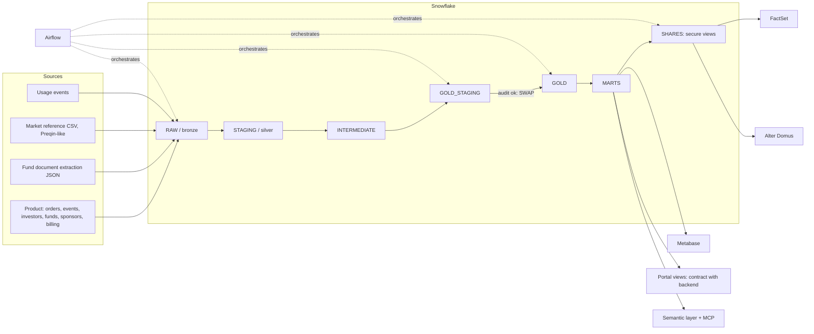
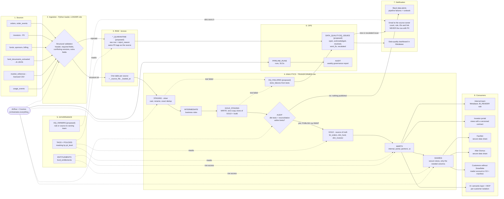
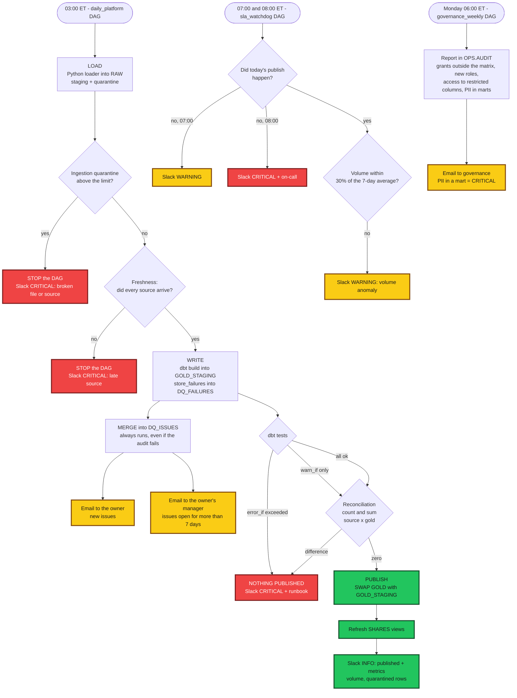
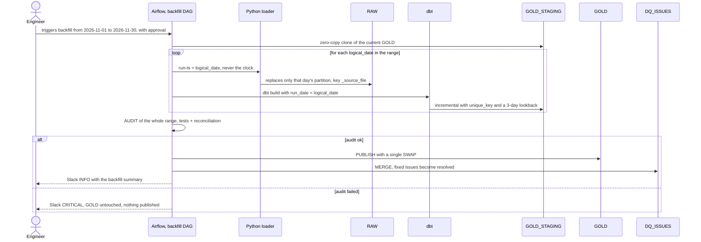

# Data platform architecture v0: SUBSCRIBE lab

> **Status:** v0, to be validated. This is a **lab with synthetic data** that reproduces SUBSCRIBE's data scope. Nothing here uses the company's real code, schemas or data.
> **Use:** architecture memory for the coordinator and the agents. Before any task, read this file, `STATE.md` and the decisions in `decisions/`.

---

## 1. Goal

Build a data platform that:
1. **Delivers reliable data to customers and partners** (North Star: go from ~10 of ~300 customers receiving data to a repeatable process).
2. **Protects sensitive data** (investor PII, per-fund entitlements, auditing).
3. **Serves the business cases:** order lifecycle and NIGO, freemium → paid, fund data quality, partners (FactSet, Alter Domus) and an AI-ready layer (MCP).

## 2. Principles
- **One source of truth:** golds in Snowflake. Marts and feeds do not create new metric logic.
- **Nothing published without tests:** write-audit-publish on every layer someone consumes.
- **Governance by default:** every column has a `pii_level`; no mart exposes PII; access through functional roles.
- **Everything as code and through PRs:** models, DAGs, roles, grants, policies and shares.
- **Idempotency:** any run can be repeated for any date without duplicating.
- **Agents build and review; the platform runs on its own.** No agent writes to production.

## 3. Overview

### 3.1 Summary view



### 3.2 Full data flow: from source to customer

> Elements marked **(proposed)** come from the quarantine flow discussion (T-019) and are designed in ADR-0011: `ORDERS_QUARANTINE` in `RAW`, `ANALYTICS.DQ_FAILURES`, `OPS.DATA_QUALITY.DQ_ISSUES` and `DQ_OWNERS`.



**One order going through the flow (example `ORD-00117`, same version key with different content):**

| Step | Where | What happens |
|---|---|---|
| 1 | `orders` source | The order system sends two rows with the same `order_id` and the same `updated_at`, but different investors and amounts (a conflict, ADR-0009; versions with different `updated_at` would be legitimate) |
| 2 | Ingestion | Structural validation detects the conflict; both rows go to `RAW.ORDERS.ORDERS_QUARANTINE` with `reject_reason = conflicting_version` |
| 3 | RAW | The other orders in the file flow normally; the quarantine inherits the source's PII tags |
| 4 | DQ_ISSUES | The `MERGE` opens an issue with `issue_key = hash(rule, order_id)`; if the collision persists tomorrow, it only updates `last_seen` |
| 5 | Notification | The owner in `DQ_OWNERS` (the order system team) gets an email with the count, rule, ID and dashboard link, with no personal data |
| 6 | Fix | The owner fixes it at the source; the next load brings one row per version key |
| 7 | Resolution | The `MERGE` no longer finds the failure and marks the issue `resolved`, with `resolved_at` |
| 8 | Gold and customers | The order enters `fct_orders` and reaches the marts, the portal and the shares only after passing the audit |

### 3.3 Daily run and notification triggers



Color legend: **red** = conservative posture, the pipeline stops and nothing is published · **yellow** = permissive posture with a warning, publish and notify · **green** = normal path. Details for each point in section 3.5.

| Trigger | When it fires | Severity | Channel | Who receives it | Gold published? |
|---|---|---|---|---|---|
| Invalid header or loader crash | At load | Critical | Slack + runbook | Data team | No |
| Ingestion quarantine above the limit | At load | Critical | Slack | Data team | No |
| Source did not arrive (freshness) | Before the build | Critical | Slack | Data team + source owner | No |
| dbt test above `error_if` | At audit | Critical | Slack + runbook | Data team | No |
| dbt test above `warn_if` | At audit | Warning | Email | Rule owner (`DQ_OWNERS`) | Yes |
| Reconciliation not zero | At audit | Critical | Slack | Data team | No |
| New issue in `DQ_ISSUES` | After the build | Warning | Email without PII + dashboard | Source owner | Yes |
| Issue open for more than 7 days | After the build | Escalation | Email | Owner's manager | Yes |
| No publish by 07:00 / 08:00 | `sla_watchdog` | Warning / critical | Slack / on-call | Data team | — |
| Volume outside 30% of the average | `sla_watchdog` | Warning | Slack | Data team | Already published |
| PII found in a mart | `governance_weekly` | Critical | Email | Governance | Already published: fix with priority |

### 3.4 Backfill: reprocess a range without duplicating



**Why the backfill does not duplicate:** time comes from the `logical_date` (never `now()`), RAW replaces the day's partition instead of appending, incrementals use `unique_key`, and gold only changes through a `SWAP` after the audit. Rollback is another `SWAP`.

### 3.5 Posture per control point: conservative × permissive

Every control point chooses between two errors: publishing wrong data (permissive) or holding back correct data (conservative). The general rule for this platform: **permissive with the individual record, conservative with the batch and with everything that reaches a customer.** Governance has no permissive mode.

| Control point | Where (3.2 / 3.3) | Posture | Limit or trigger | Why | Decision |
|---|---|---|---|---|---|
| Row with a structural error | Ingestion | Permissive per row | The row goes to quarantine; the rest continues | One bad order should not stop the business | ADR-0002, ADR-0011 |
| Quarantine volume | Ingestion (LQ) | Conservative per batch | Above the limit, the DAG stops | Many rejections = broken file or source | ADR-0011 |
| Version conflict, including an incomplete row with the same key | Ingestion | Conservative | Both occurrences go to quarantine | No rule says which one is true | ADR-0009 (F1) |
| Versions and exact duplicates | Staging / intermediate | Permissive | `row_number` by `updated_at` | There is a business rule: the latest version wins | ADR-0009 |
| Late source | Freshness (FR) | Conservative | `error_after` | Publishing incomplete data looks like correct data | ADR-0010 |
| Semantic test | Audit (TST) | By threshold | `warn_if` publishes and warns; `error_if` stops | Small noise × systemic breakage | ADR-0011 |
| Reconciliation | Audit (REC) | Conservative | Difference ≠ 0 stops | A count or sum difference is lost or invented data | Section 11 |
| Gold publish | Publish | Conservative | Only `SWAP` after the audit | Consumers never see a half-finished build | Section 9 |
| Portal view and application | Marts / portal | Conservative + last known good | On failure, keep the previous version, with its date | Customers never see an empty screen or an unaudited number | ADR-0012 |
| Isolated data quality issue | DQ_ISSUES | Permissive with a warning | Publish and notify the owner | The owner fixes it at the source; the rest of the data flows | ADR-0011 |
| Volume or sum anomaly | `sla_watchdog` | Permissive with a warning | Outside 30% of the average: warning | Could be real business; a human decides | Section 11, RB-001 |
| PII in a mart, access outside the matrix | `governance_weekly` | Conservative, always | Critical and priority fix | Improper access cannot be undone | Section 7 |

## 4. Sources (synthetic in the lab)

| Source | Content | Sensitivity |
|---|---|---|
| `organizations` | Customer organizations (sponsors and advisor firms) | Internal |
| `orders` | Versioned subscription order: organization, investor, fund, amount, currency, channel, status, `updated_at` (ADR-0009) | Internal |
| `order_events` | Order states: submitted, sponsor_review, nigo, approved, signed, completed, cancelled | Internal |
| `orders_json` | Order document as JSON: investor, product, status and NAV history (ADR-0014) | **PII** (investor name) |
| `fx_rates` | Daily exchange rates to USD (synthetic seed in phase 0, ADR-0013) | Public |
| `investors` | Name, email, tax ID, date of birth, KYC | **Restricted/confidential PII** |
| `funds` | Name, type, strategy, sector, fees, minimums, terms | Internal |
| `sponsors` | Fund managers (GPs) | Internal |
| `billing`, `billing_contract`, `billing_contract_fee` | Contracts and fees (basis for freemium) | Confidential |
| `fund_documents_extracted` | AI extraction output (JSON), with per-field confidence | Internal |
| `market_reference` | External fund classification (Preqin-like) | Licensed |
| `usage_events` | Platform usage by sponsor and advisor | Internal |
| `fund_entitlements` | Which advisors/firms can see which funds | Confidential |

**Ingestion:** at SUBSCRIBE, Airbyte. In the lab, a Python loader → stage → `COPY INTO` into `RAW`, with a `_loaded_at` column.

## 5. Snowflake

### Databases and schemas
| Database | Schemas | Use |
|---|---|---|
| `RAW` | one per source | Bronze: data as it arrived |
| `ANALYTICS` | `STAGING`, `INTERMEDIATE`, `GOLD`, `GOLD_STAGING`, `MARTS`, `SHARES` | Silver, gold, WAP, consumption, external exposure |
| `GOVERNANCE` | `TAGS`, `POLICIES`, `ENTITLEMENTS` | PII tags, masking, row access, access maps |
| `OPS` | `PIPELINE_RUNS`, `AUDIT` | Runs, SLOs, governance reports |
| `ANALYTICS_DEV` | `PR_<n>_*` and one per developer | CI and development |

### Functional roles
| Role | Can | Cannot |
|---|---|---|
| `LOADER` | Write to `RAW` | Read gold |
| `TRANSFORMER` | Read `RAW`, write `ANALYTICS`; sees unmasked PII (otherwise it would write masked values into gold) | Be granted to people |
| `ANALYST` | Read `GOLD` and `MARTS`, PII masked | Write |
| `BI_READER` | Read `MARTS` (Metabase) | Read `RAW`/`STAGING` |
| `PORTAL_READER` | Read portal views | Read anything else |
| `PARTNER_FACTSET`, `PARTNER_ALTER_DOMUS` | See only their own share | Anything else |
| `GOVERNANCE_ADMIN` | Create tags, policies, entitlements | Read business data |
| `GOVERNANCE_AUDITOR` | Read metadata (`ACCOUNT_USAGE`: grants, tags, access) | Read data |
| `CI_ROLE` | Write to `ANALYTICS_DEV` | Touch production |

### Warehouses
`LOAD_WH`, `TRANSFORM_WH`, `BI_WH`, `CI_WH`: all XS, `auto_suspend = 60`, with a resource monitor. Reader accounts with their own warehouse and monitor.

## 6. dbt

### Structure
```
models/
  staging/        stg_<source>__<table>   views, cast + rename + known dedup
  intermediate/   int_order_events_sequenced, int_fund_classification_mapped
  gold/
    orders/       fct_orders, fct_order_events, fct_sponsor_reviews (NIGO)
    funds/        dim_fund (official taxonomy), fct_fund_completeness
    parties/      dim_investor (PII with tags), dim_sponsor (paid/free), dim_advisor
    usage/        fct_sponsor_activity
  marts/
    internal/     mart_cs_client_health, mart_sponsor_growth (freemium), mart_product_onboarding
    portal/       mart_portal_investor_positions_v1 (contract with backend)
    partners/     mart_partner_factset_v1, mart_partner_alter_domus_v1
    ai/           mart_mcp_orders, mart_mcp_funds
seeds/            fund_taxonomy, fund_classification_map
snapshots/        snap_funds (terms, fees, strategy), snap_investor_kyc
tests/            singular: order lifecycle, reconciliation, no PII in marts
macros/           governance (tags, row access), publish_gold (SWAP), generate_schema_name
```

### Rules (the reviewer checks)
- Every gold: PK with `unique` + `not_null`, description, `meta.owner`.
- Every column: `meta.pii_level` (`restricted`, `confidential`, `internal`, `public`).
- Input tests on staging, so dbt skips gold when the input is wrong.
- Partner and portal marts: `contract: enforced`, `versions`, `exposures`, `grants`.
- `store_failures` on critical tests.
- Source × gold reconciliation (count and sum of amounts).
- Incrementals with `unique_key` and a 3-day lookback window.

## 7. Governance
- **PII:** `PII_LEVEL` tag + tag-based masking (string, date). A post-hook reapplies tags after `create or replace`.
- **Per-fund entitlements:** `GOVERNANCE.ENTITLEMENTS.FUND_ENTITLEMENTS` + a row access policy on marts that go to the portal and partners.
- **External exposure:** only secure views in the `SHARES` schema; one share per partner, with only the needed columns.
- **Auditing:** weekly report (`OPS.AUDIT`): grants outside the matrix, new roles, access to restricted columns, marts with PII.
- **Access matrix:** `memory/governance/access_matrix.md`, approved by humans.

## 8. Orchestration (Airflow + Cosmos)

| DAG | When | What it does |
|---|---|---|
| `daily_platform` | 03:00 ET | Load → freshness → `dbt build` (gold into `GOLD_STAGING`) → reconciliation → **publish (SWAP)** → refresh share views → notify |
| `sla_watchdog` | 07:00 and 08:00 ET | Warning and critical alert if the publish did not happen |
| `governance_weekly` | Monday 06:00 ET | Produces the audit report |
| `backfill` | Manual | Reprocesses a date range, idempotently |

Retries only for transient errors, with backoff. Timeouts on every task. Failure → Slack alert with a runbook link.

## 9. Write-audit-publish
1. **Write:** `dbt build --vars '{gold_schema: GOLD_STAGING}'`
2. **Audit:** dbt tests + reconciliation. Failed → stop, alert, nothing published.
3. **Publish:** `ALTER SCHEMA ANALYTICS.GOLD SWAP WITH ANALYTICS.GOLD_STAGING`.
4. **Rollback:** another `SWAP` goes back to the previous version.
5. **Watch out:** grants, tags and policies must exist on both schemas.

## 10. CI/CD (GitHub Actions)
- **CI on the PR:** `sqlfluff` + `ruff` + `pytest` + offline `dbt parse` + project rules (manifest) → `dbt build --select state:modified+ --defer` into `PR_<n>_*` → artifacts → cleanup job when the PR closes.
- **CD on `main`:** `production` environment with approval → build with WAP → publishes `manifest.json` (Slim CI state).
- **Infrastructure as code:** roles, warehouses, grants, tags, policies and shares through Terraform or versioned scripts, with `plan` on the PR and an approved `apply`.
- **Protection:** protected `main`, required status checks, CODEOWNERS, PR template.

## 11. Observability and SLOs
| SLO | Target |
|---|---|
| Gold publish | by 07:00 ET on 99% of days |
| Daily volume | within ±30% of the 7-day average |
| PII in marts | zero |
| Reconciliation | zero difference in count and sum |

Signals: freshness, volume, **sum of amounts in USD against the 7-day average** (an amount jump with normal volume only shows up here), grain (`count(*)` = `count(distinct key)` on every gold), schema (contracts), distribution (% nulls), lineage (exposures). Investigating jumps: `memory/runbooks/RB-001-metric-jumped.md`. Runs in `OPS.PIPELINE_RUNS`. Runbooks in `memory/runbooks/`.

## 12. Distribution
| Consumer | Channel | Owner |
|---|---|---|
| Internal team | Metabase on `MARTS` (`BI_READER` role) | Data |
| Investor portal | Views with a contract | Data delivers the view; backend builds the API |
| FactSet, Alter Domus | Secure data sharing (or a listing, if another region/cloud) | Data |
| Customers without Snowflake | Reader account or a file in S3 with a manifest | Data |
| AI | Semantic layer + MCP over `mart_mcp_*`, per-customer isolation | Data + backend |

## 13. Agents (how they build this platform)
| Agent | Touches | Never |
|---|---|---|
| Coordinator | Plans, breaks work into tasks, updates `STATE.md` | Merges |
| Builder | dbt code, DAGs, governance SQL, tests | Writes to production |
| Reviewer | Reads the diff and test results; comments | Changes code |
| Governance | Reads code and metadata (`GOVERNANCE_AUDITOR` role) | Reads data, grants access, changes policies |

Agent conclusions are auxiliary checks, not guarantees. Approval is human.

Runtime and current role names (first mate, Ship crewmate, architecture and governance Scouts): ADR-0016 and `memory/agent-workflow.md`.

## 14. Lab roadmap
| Phase | Delivers |
|---|---|
| 0 | **Walking skeleton (ADR-0008):** F0.1 Python ingestion with versioning (ADR-0009); F0.2 dbt with `organizations`, `orders`, `order_events`, `fx_rates` and `org_summary`; F0.3 Snowflake `RAW` + quarantine + CI; F0.4 orders JSON with NAV and reconciliation (ADR-0014) |
| 1 | Snowflake: roles, warehouses, `RAW` loaded |
| 2 | dbt: staging → gold → marts with tests and docs |
| 3 | Governance: PII, entitlements, auditing |
| 4 | Airflow + WAP + alerts + SLOs |
| 5 | CI/CD with Slim CI and infrastructure as code |
| 6 | Partner shares + file feed |
| 7 | Data products: freemium, fund quality |
| 8 | Semantic layer + MCP |

## 15. Assumptions to confirm at SUBSCRIBE (not verified)
- [ ] Where dbt runs today and whether there is an orchestrator (Airflow does not exist yet, from what I heard)
- [ ] Region and cloud of the FactSet and Alter Domus Snowflake accounts
- [ ] Source of truth for "who pays" (assumption: billing tables)
- [ ] Where per-fund entitlements live today
- [ ] Policy on using AI assistants with company code
- [ ] Whether Terraform or another infrastructure-as-code tool exists

## 16. Out of scope for now
Real-time streaming, data mesh, warehouse migration, data monetization (comes after the foundation).
